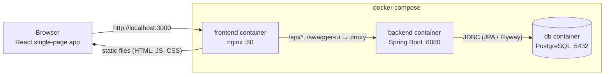
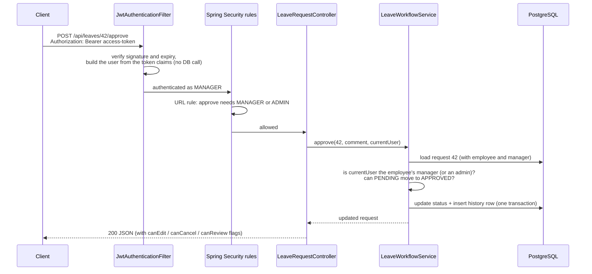
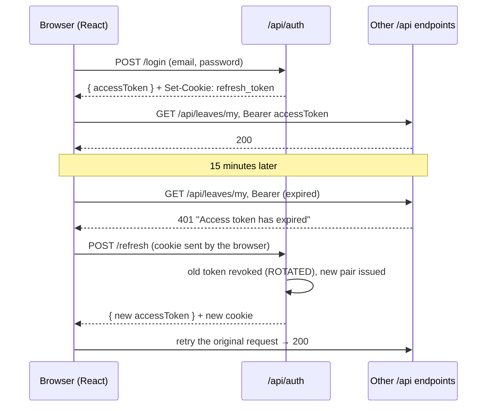
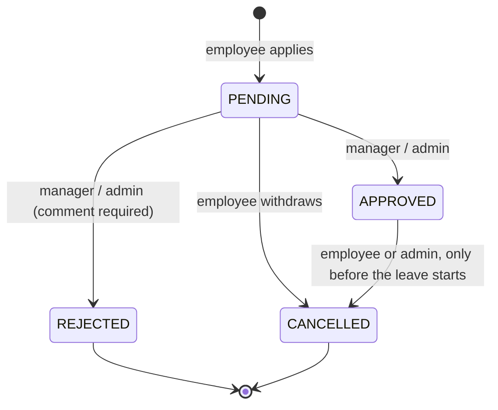
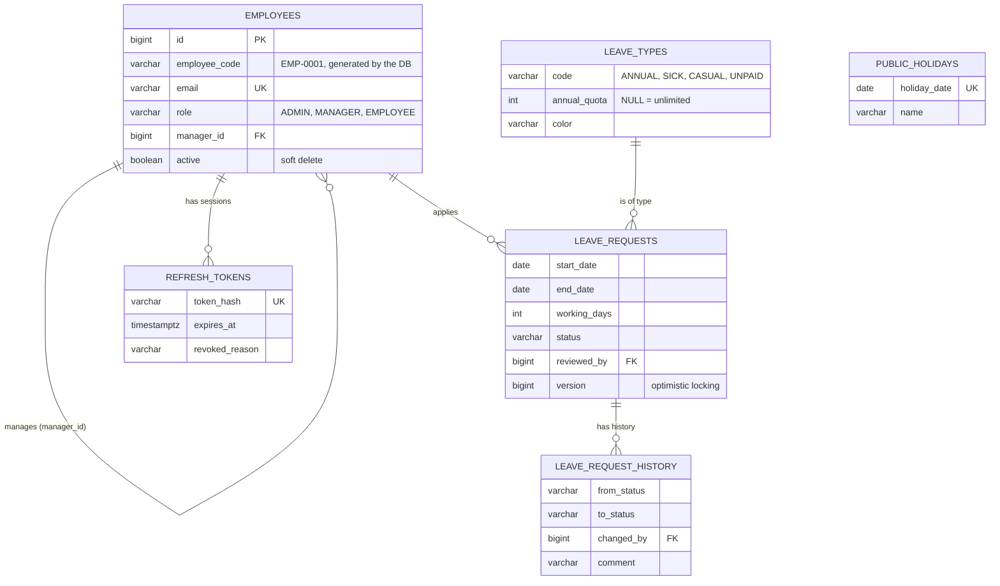

# LeaveFlow: How It Works

This document explains the architecture of LeaveFlow: the main components, how a request travels through the backend,
how authentication works, the leave rules, the data model and the Docker setup. The [README](README.md) covers how to run it.

## 1. The big picture



- **Frontend:** a React app built by Vite into static files. nginx serves them and forwards API calls to the backend.
- **Backend:** a Spring Boot REST API. It holds all business rules and is the only component that talks to the database.
- **Database:** PostgreSQL. The schema is created and versioned by Flyway migrations.

Because the browser only ever talks to one address (nginx), the frontend and API share an origin. So there is no CORS in
production, and the refresh-token cookie can be `SameSite=Strict`. In development the Vite dev server plays nginx's role
by proxying `/api` to `localhost:8080`.

## 2. Backend

### 2.1 Package layout (by feature)

Code is grouped by feature rather than by layer, so everything about leave requests sits in one place:

| Package | What it contains |
|---|---|
| `auth` | Login, refresh, logout, current user, change password; `auth.refresh` holds the refresh-token table and service |
| `security` | `SecurityConfig`, `JwtService`, `JwtAuthenticationFilter`, the JSON 401/403 handlers |
| `employee` | Employee entity, CRUD, search with filters, team and manager look-ups |
| `leave` | Leave requests, the status state machine, balances, working-day calculation, approvals, audit history, permissions |
| `leave.type` / `holiday` | Leave types (read-only) and public holidays (admin CRUD) |
| `dashboard` | Aggregate queries for the three dashboards and the team calendar |
| `demo` | Loads sample leave data into an empty database |
| `common` | Base entity, error handling, paging response, clock and OpenAPI config |

Inside each feature, the layers are always the same:

```
Controller  →  Service  →  Repository  →  Entity
(HTTP, DTOs)   (rules, @Transactional)   (Spring Data JPA)   (JPA-mapped table)
```

- **Controllers** only translate HTTP to method calls. They accept and return Java `record` DTOs, never entities.
- **Services** hold the business rules and run inside transactions.
- **Repositories** are Spring Data interfaces. Search screens use JPA `Specification`s, so optional filters (status, type,
  dates, name) combine without writing a query for every combination.

### 2.2 Life of a request

Take `POST /api/leaves/42/approve` from a manager:



Authorisation happens at three levels:
1. **URL rules** in `SecurityConfig`: public endpoints (login, refresh, Swagger, health), everything else needs a token.
   Write endpoints that take a JSON body and need a role (employee and holiday writes, approve and reject) also get a URL rule.
   The reason: Spring validates the body (`@Valid`) *before* method security runs, so without the URL rule a user without
   the role would get a 400 validation error instead of a 403.
2. **Role checks** on controller methods with `@PreAuthorize("hasRole('ADMIN')")`.
3. **Ownership checks** in the services, e.g. "only the employee's own manager can approve". These rules live in one class,
   `LeavePermissions`. It is used both to enforce an action and to fill the `canEdit` / `canCancel` / `canReview` flags in
   every response, so the buttons the UI shows can never disagree with what the API allows.

### 2.3 Errors

Every error (validation, business rule, not found, forbidden, expired token, conflict) returns the same JSON shape:

```json
{ "timestamp": "...", "status": 400, "error": "Bad Request",
  "message": "Not enough Annual Leave balance: 6 day(s) requested, 4 available",
  "path": "/api/leaves", "fieldErrors": { "reason": "must not be blank" } }
```

`GlobalExceptionHandler` maps exceptions to this shape; the security handlers produce it for 401 and 403. The frontend
reads `message` for toasts and `fieldErrors` to highlight form fields.

## 3. Authentication

LeaveFlow uses the standard **access token + refresh token** model.

| | Access token | Refresh token |
|---|---|---|
| Format | JWT signed with HS256 (claims: id, email, name, role) | 32 random bytes, Base64url |
| Lifetime | 15 minutes | 7 days |
| Client keeps it | In a JavaScript variable (memory only) | `HttpOnly`, `SameSite=Strict` cookie on path `/api/auth` |
| Server keeps it | Nothing, it is checked by signature | SHA-256 hash in `refresh_tokens` |
| Revocable | No, which is why it is short-lived | Yes |



Details worth knowing:
- **No DB lookup per request.** The filter trusts the signed claims. The trade-off is that a role change or deactivation
  takes effect when the current access token expires (at most 15 minutes). Deactivation and password change revoke all
  refresh tokens immediately, so the user cannot get a new access token.
- **Rotation and reuse detection.** Every refresh revokes the used token with reason `ROTATED`. If a `ROTATED` token is
  presented again, someone probably copied it, so all of that user's sessions are revoked. Tokens revoked for other
  reasons (logout, password change) are simply rejected. This keeps a phone that was logged out by a password change
  from wiping out the laptop's new session.
- **Why the cookie is safe.** JavaScript cannot read an `HttpOnly` cookie, so an XSS bug cannot steal the long-lived token.
  `SameSite=Strict` means other sites cannot make the browser send it, and `Path=/api/auth` means it only travels to the
  auth endpoints.
- **Frontend side (`frontend/src/api/client.js`).** An axios interceptor catches a 401, calls `/refresh` once and retries.
  If several requests fail at the same moment, they share one refresh call ("single flight"). On page load the app calls
  `/refresh` to restore the session, because the access token in memory is lost on reload.
- Passwords are hashed with BCrypt. A nightly job deletes expired refresh tokens.

## 4. Leave rules

### 4.1 Status state machine



The allowed moves are defined in `LeaveStatus.canTransitionTo()`. Only `PENDING` requests can be edited. Every change,
including the first submission and edits, writes a row to `leave_request_history`, which the UI shows as a timeline.

### 4.2 Validation when applying

`LeaveRequestService.evaluate()` checks every rule and **collects all problems** instead of stopping at the first one.
The same method powers `GET /api/leaves/preview`, so the form shows live feedback such as "4 days of leave · 11 days available"
before the user submits.

- The end date must not be before the start date, and a request cannot cross into the next year (balances are yearly).
- It cannot start in the past. "Today" comes from an injected `Clock` in the Asia/Dhaka time zone, not the server's zone.
- **Working days** skip the weekend (Friday and Saturday, configurable) and public holidays from the `public_holidays` table.
  A range with zero working days is rejected.
- No overlap with the employee's own pending or approved leave.
- Enough balance for the leave type.

### 4.3 Balances

Balances are **calculated, not stored**: `available = yearly quota − approved days − pending days` for that year.
Counting pending days stops someone from submitting several requests that are fine one by one but exceed the quota
together. With no separate balance table, there is nothing to get out of sync when a request is cancelled or rejected.
Unpaid leave has no quota (`annual_quota` is `NULL`).

### 4.4 Concurrency

`leave_requests` has a `version` column (JPA `@Version`). If two reviewers act on the same request at once, the second
save fails with a 409 instead of silently overwriting the first decision.

## 5. Data model



- **Schema ownership.** Flyway migrations (`backend/src/main/resources/db/migration`, V1–V4) create the tables and seed the
  demo employees, leave types and 2026 Bangladesh holidays. Hibernate runs with `ddl-auto: validate`: it only checks
  that the entities match the schema and never changes it.
- **Soft delete.** "Deleting" an employee sets `active = false`, keeping their leave history intact.
- **Database constraints** back up the Java rules: `end_date >= start_date`, `working_days > 0`, allowed status and role
  values, and an employee cannot be their own manager.

## 6. Frontend

```
src/
  api/          client.js (axios, tokens, refresh) · endpoints.js (one function per API call)
  auth/         AuthContext (who is logged in) · ProtectedRoute (login and role guard)
  components/   ui/ (Button, Modal, Badge, ...) · layout/ (sidebar) · leave/ · dashboard/ (charts)
  hooks/        useAsync (loading / error / data for a request) · useDebouncedValue
  pages/        one file per screen, lazy-loaded
  utils/        date formatting and error-message helpers
```

- **Routing and roles.** `App.jsx` wraps pages in `ProtectedRoute`. Approvals and Team Calendar need MANAGER or ADMIN, and
  Employees needs ADMIN. The sidebar hides links the same way. This only affects what is shown; the backend enforces
  the real rules.
- **Dashboards per role.** Everyone sees their balances and upcoming leave (`/api/dashboard/me`). Managers also see who is
  away today and soon (`/team`). Admins also get company charts (`/organisation`): approved days by type, month and
  department, and headcount by department, drawn with Recharts.
- **Team calendar.** One row per person, one column per day. Weekends and holidays are shaded, and pending leave is
  striped. It is plain table markup, with no calendar library.
- **Code splitting.** Pages load with `React.lazy`, so the login screen does not download the chart library.

## 7. Docker

| Service | Image (build) | Notes |
|---|---|---|
| `db` | `postgres:17-alpine` | Data in the `db-data` volume; `pg_isready` healthcheck |
| `backend` | Maven build stage → `eclipse-temurin:17-jre-alpine` | Runs as a non-root user; healthcheck on `/actuator/health`; starts after `db` is healthy |
| `frontend` | Node build stage → `nginx:1.29-alpine` | Serves `dist/`, proxies `/api`; starts after `backend` is healthy |

- **Multi-stage builds.** The final images contain only what is needed to run (a JRE plus the jar, or nginx plus static
  files), not Maven, Node or the source code. Dependencies are copied and downloaded before the source, so Docker
  caches that layer and rebuilds after a code change are fast.
- **nginx (`frontend/nginx.conf`).**
  - Proxies `/api`, Swagger UI and the OpenAPI JSON to `http://backend:8080`. `backend` is the compose service name,
    which Docker's internal DNS resolves.
  - Unknown paths fall back to `index.html`, so reloading `/leaves` works (React Router takes over in the browser).
  - Hashed asset files are cached for a year; `index.html` is never cached, so a new build is picked up immediately.
- **Configuration.** Everything comes from environment variables with defaults (`${VAR:-default}` in compose,
  `${VAR:default}` in `application.yml`), so the same jar runs locally and in a container. `.env.example` lists what can
  be changed.

## 8. Testing

- **159 backend tests**, all runnable without a database (`./mvnw test`):
  - **Unit tests with Mockito** for the services: validation rules, balances, the state machine, workflow permissions,
    token rotation and reuse detection, the working-day calculator and the dashboards.
  - **`@WebMvcTest` slice tests** for controllers and security: which role gets 200, 401 or 403, the JSON error shape,
    and the whole login → refresh → logout cookie flow.
- **Frontend:** checked with ESLint and a production build, then tested by hand in the browser for all three roles.
  This included a 10-second access token, used to watch the silent refresh work.
- **Docker:** a clean `docker compose up --build`, followed by the same flows through nginx.

## 9. Decisions and trade-offs

| Decision | Why | Trade-off |
|---|---|---|
| Stateless access token + stored refresh token | No DB lookup per request, but sessions can still be revoked | Role changes apply within 15 minutes, not instantly |
| Balances computed from requests | One source of truth; nothing to keep in sync | A small aggregate query each time a balance is shown |
| Business rules in services, one `LeavePermissions` class | Easy to unit test; UI flags match the API | Services get fairly long |
| Flyway + `ddl-auto: validate` | Schema changes are versioned and reviewable | Every change needs a new migration file |
| nginx proxy, one origin | No CORS, strict cookie works | One more container |
| Injected `Clock` (Asia/Dhaka) | "Today" is correct regardless of server time zone, and tests can fix the date | Code must never call `LocalDate.now()` directly |

**Known limitations**
- If the only admin applies for leave and has no manager, nobody else can approve it.
- Editing a public holiday does not recalculate the working days of requests already submitted.
- Two browser tabs refreshing at exactly the same moment can trigger reuse detection and force a new login.
- Out of scope on purpose: email notifications, half-day leave, file attachments, multi-level approval.
